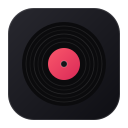

<p align="center">
  
</p>

<h1 align="center">VinylDesk</h1>

<p align="center">
  <strong>Turn Apple Music into a tactile vinyl ornament &amp; minimal desktop widget for macOS.</strong>
</p>

<p align="center">
  <a href="README.md">English</a> ·
  <a href="README_CN.md">简体中文</a>
</p>

<p align="center">
  
  
  
  
</p>

---

> **No Electron. No API keys. No Dock clutter. Just pure native SwiftUI & AppKit craft.**
>
> **VinylDesk** sits quietly on your macOS desktop—either as a physical album sleeve with a gently spinning vinyl record, or as a sleek frosted-glass mini card—complete with floating cinema-style synced lyrics.

<!--
💡 TIP: Drop a 10–15s GIF or screenshot of VinylDesk on your wallpaper into `docs/demo.gif` and uncomment below!
<p align="center">
  
</p>
-->

---

## ✨ Highlights

### 💿 Dual Aesthetic Modes (1-Click Switch)
- **Vinyl Record Ornament** — A physical album sleeve with a half-exposed spinning vinyl disc (realistic micro-grooves, fixed specular light sheen, rotating center label). When playing, the vinyl glides smoothly out of the sleeve and spins; when paused, it coasts naturally to a stop at its exact angle and tucks back slightly. Pure art at rest—track details & controls appear only on hover.
- **Minimal Frosted Card** — Native `NSVisualEffectView` horizontal card tinted with an ambient glow extracted from your current album cover. Features smooth marquee scrolling for long titles, an ultra-thin scrubbable progress bar, and hover-revealed playback controls.

### 🎬 Cinema-Style Synced Lyrics
- **Frameless Subtitle Aesthetic** — Floating lyrics beneath the vinyl with layered adaptive shadows (crisp over both light and dark wallpapers), plus switchable **Ambient Cover Glow** and **Frosted Pill** styles.
- **3 Curated Font Styles** — Switch live between **Vintage Serif** (New York / Songti), **Modern Sans** (SF Pro / PingFang), and **Soft Rounded**.
- **Multi-Source + Bilingual + Cached** — Fetches synced `.lrc` from open-source **LRCLIB** with automatic Chinese library fallback & optional bilingual translation (`原文 + 翻译`), cached locally on disk.

### 🪶 Built Like a Native macOS App
- **Zero-Focus Disruption** — Non-activating `NSPanel`: click play/pause, skip tracks, or scrub timelines without ever stealing focus from your editor or browser.
- **Floating or Desktop Layer** — Defaults to always-on-top floating; switch to wallpaper-level desktop widget mode anytime (stays visible across all Spaces).
- **1:1 Smooth Drag & Position Lock** — Drag anywhere on the sleeve, disc, or card; lock position to prevent accidental moves; auto-hides gracefully when Apple Music quits.
- **HD Artwork Fallback** — Reads artwork directly from Apple Music first, with automatic `600×600` iTunes Search API fallback & caching for cloud streaming tracks.
- **Tiny Footprint** — 100% pure Swift & SwiftUI, zero third-party packages, menu-bar-only (`LSUIElement`), ~0% CPU when paused.

---

## 📦 Installation

### Option 1: Download Prebuilt App (Recommended)
1. Download the latest `VinylDesk-macOS.zip` from [**Releases**](https://github.com/Marbacj/VinylDesk/releases).
2. Unzip and drag `VinylDesk.app` into `/Applications`.
3. Launch `VinylDesk` and grant Automation access to **Music** when prompted.

> **Note on unsigned local builds:** Since VinylDesk is free and open-source without a paid Apple Developer ID notarization, macOS Gatekeeper may ask for confirmation on first open. Right-click `VinylDesk.app` → **Open**, or run:
> ```bash
> xattr -cr /Applications/VinylDesk.app
> ```

### Option 2: Build from Source (Requires macOS 14+ & Xcode / Swift 6)
```bash
git clone https://github.com/Marbacj/VinylDesk.git
cd VinylDesk
./scripts/build-app.sh

# Move to Applications & launch
cp -R build/VinylDesk.app /Applications/
open /Applications/VinylDesk.app
```

---

## 🎛 Controls & Shortcuts

| Action | How |
| :--- | :--- |
| **Move widget** | Press and drag anywhere on the vinyl, sleeve, or card |
| **Open Apple Music** | Single-click the album cover |
| **Playback controls** | Hover over the sleeve or card (`Prev` / `Play-Pause` / `Next`) |
| **Seek progress** | Click or drag the thin progress bar in Minimal Card mode |
| **Switch mode & style** | Right-click the widget or click the **Menu Bar** vinyl icon |
| **Launch at Login** | Menu Bar icon → **开机自动启动** (best when installed in `/Applications`) |

---

## 🏗 Architecture

```text
Sources/VinylDesk/
├── App/
│   ├── VinylDeskApp.swift            # @main entry & MenuBarExtra
│   ├── AppDelegate.swift             # Lifecycle & observation coordinator
│   └── FloatingPanelController.swift # Non-activating NSPanel, 1:1 drag, layering
├── Models/
│   ├── TrackState.swift              # Track metadata & playback status
│   ├── LyricLine.swift               # Synced & bilingual lyric model
│   └── AppSettings.swift             # Persisted preferences (mode, size, fonts, effects)
├── Services/
│   ├── AppleMusicBridge.swift        # DistributedNotificationCenter + AppleScript sync
│   ├── ArtworkService.swift          # Local artwork -> iTunes Search HD fallback + cache
│   ├── LyricsService.swift           # LRCLIB + fallback + bilingual matching + cache
│   ├── LRCParser.swift               # Multi-timestamp & offset LRC parser
│   ├── ColorExtractor.swift          # CoreImage CIAreaAverage ambient tint extractor
│   └── LoginItemManager.swift        # SMAppService Launch-at-Login wrapper
└── Views/
    ├── WidgetRootView.swift          # Mode switcher, unified tap/drag, context menu
    ├── VinylRecordView.swift         # Sleeve + spinning vinyl disc physics
    ├── MinimalCardView.swift         # Frosted glass card, marquee, scrubbable bar
    ├── LyricsOverlayView.swift       # Cinema subtitle, ambient glow & frosted pill
    ├── VisualEffectView.swift        # AppKit NSVisualEffectView & MarqueeText
    └── MenuBarView.swift             # Native macOS menu bar controls
```

---

## 🗺 Roadmap

- [x] Vinyl Sleeve + Half-Exposed Spinning Record with coasting deceleration
- [x] Minimal Frosted Card with album-color ambient glow & scrubbable progress bar
- [x] Synced LRC lyrics with bilingual translation & local disk cache
- [x] Cinema subtitle / ambient glow / frosted pill typography & 3 font styles
- [ ] Optional tonearm (唱针) toggle for full turntable mode
- [ ] Global keyboard shortcuts (show/hide, switch mode, favorite track)
- [ ] Spotify & NetEase Cloud Music adapter support
- [ ] Homebrew Cask formula (`brew install --cask vinyldesk`)

---

## 🤝 Contributing

Issues, design suggestions, and Pull Requests are warmly welcome!
Run the test suite locally with:

```bash
swift test --disable-sandbox
```

---

## 📄 License

Released under the [MIT License](LICENSE). If VinylDesk makes your desktop a little nicer, consider giving it a ⭐!
